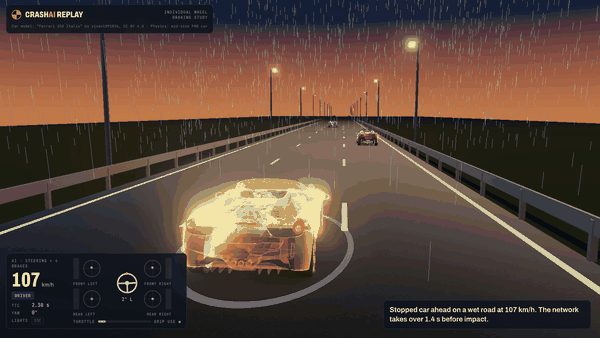
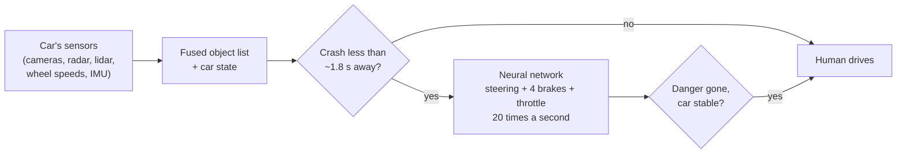

# CrashAI

**Your car can brake each wheel on its own. You can't. Can a neural network use that to steer out of a crash?**



<sub>Recorded from the 3D replay viewer ([full-quality MP4](media/replay.mp4)). Yellow car: the network with steering and four separate brakes. Glass-like cars: the other five controllers in the same emergency. The x-ray body shows each brake disc glowing with its own brake force. Bottom left: speed, steering, each wheel's brake force and grip use per tire.</sub>

## The big idea

Every modern car can already brake each wheel separately. The hardware is there for ABS and stability control. But the driver gets one pedal that brakes all four wheels together, and no person could work four brakes independently in the second before a crash anyway.

Uneven braking does more than slow a car down. **It turns it.** Brake only the left wheels and the nose swings left, the same way a tank steers by slowing one track. So every car carries a second steering system that nobody uses on purpose.

**The claim:** a neural network that controls steering, all four brakes and the throttle can learn to use that hidden control and avoid crashes that a driver with one pedal can't.



The network works like today's automatic emergency braking (AEB): it stays silent until a crash is about to happen, takes over, and hands control back once the danger has passed.

## What we found

Every controller faced the same **1,000 simulated emergencies**: stopped vehicles, cars braking hard ahead, cut-ins, and pedestrians stepping out from behind parked cars, on dry, wet, snowy and icy roads. Every hand-back was checked by letting an alert driver drive on for 4 seconds.

| Controller | Crash rate | Average impact |
|---|---|---|
| Driver only, no system | 87% | 46 km/h |
| Full braking with ABS (like today's AEB) | 44% | 14 km/h |
| Braking + scripted swerve + ESC | 29% | 11 km/h |
| **Network: steering + one brake pedal** (ESC on) | **13%** | 4 km/h |
| **Network: steering + four separate brakes** | **15%** | 5 km/h |
| **Network: four separate brakes, no steering** | **25%** | 7 km/h |

1. **Learned control halves crashes** compared with the best hand-written rule, and cuts the average impact speed from 11 km/h to 4–5 km/h.
2. **Braking alone can steer the car.** With the steering wheel frozen, the network brakes unevenly to change lanes and crashes in 25% of emergencies. That's fewer than today's straight-line emergency braking (44%) and even fewer than the scripted controller that can steer (29%). It's a strong fallback if steering fails.
3. **With steering available, four brakes haven't beaten one pedal yet** (15% vs 13%). The single-pedal car still has ESC, which already brakes individual wheels by hand-tuned rules, and the tires are usually at their grip limit already when the car swerves. See [what to try next](#whats-next).

Full tables by scenario and road surface are in [results/RESULTS.md](results/RESULTS.md).

### A lesson on the way: the networks learned to cheat

In the first training round, the networks scored 21–22% crashes, which looked great. The animations showed otherwise: a network would twitch the car so the danger check briefly predicted a miss, hand control back, and let the driver crash a moment later. Re-scored honestly, they crashed in 44–64% of emergencies. The fix was to keep simulating after every hand-back and count a later crash as the network's crash. All the results above use that check.

## Watch it

**3D replay viewer** ([viewer/index.html](viewer/index.html)): all six controllers drive the same emergency in one scene. Follow any of them, switch between chase, brake close-up, top-down and free cameras, and turn on x-ray, tire-force arrows and what the car's sensors reported.

```bash
python -m http.server 8000 -d viewer      # then open http://localhost:8000
```

Keys: Space play/pause, ←/→ step, 1–6 follow a controller, C camera, X x-ray, F forces, S sensors.

**2D comparisons** (matplotlib) in [media/](media/), for example [a stopped car on a wet road with every controller](media/stopped_wet_all_controllers.gif).

## How it works

| Part | What it is |
|---|---|
| **Car** | An ordinary 1,500 kg front-wheel-drive car with one throttle and an open differential, so the result applies to most cars on the road |
| **Physics** | Our own 2D simulator, compiled with numba, running at 500 Hz: 4 wheels, Pacejka tires where braking and cornering share one grip budget, weight transfer, ABS, ESC, steering and brake-pressure delays |
| **Sensors** | The fused object list a 2025-era car with cameras, radar and lidar produces, with noise, 50–100 ms delay, missed and false detections, and objects hidden behind others |
| **Emergencies** | Randomised stopped vehicles, hard braking ahead, cut-ins and pedestrians, on dry, wet, snowy and icy roads, with slippery patches and traffic blocking escape lanes |
| **Learning** | SAC (Stable-Baselines3), 1M steps per network, about 2 hours on a MacBook CPU |
| **Tests** | 24 checks, including: ABS braking reaches μg, braking one side turns the car that way, and the open-differential brake trick works |

Every design decision, with the reasons, is in [docs/DESIGN.md](docs/DESIGN.md).

## Quick start

macOS or Linux, Python 3.12, no graphics card needed.

```bash
uv venv --python 3.12 .venv && source .venv/bin/activate
uv pip install -e ".[dev]"
pytest

python scripts/train.py --controls full          # steering + 4 brakes + throttle
python scripts/train.py --controls pedal         # steering + 1 pedal + throttle (ESC on)
python scripts/train.py --controls brakes_only   # 4 brakes + throttle, steering frozen
python scripts/evaluate.py --n 250               # every controller on the same 1,000 emergencies

python scripts/export_viewer.py                  # record showcase emergencies for the 3D viewer
python scripts/watch.py --scenario cut_in --seed 3   # 2D side-by-side GIF
```

To re-record the video, run the viewer on port 8766 and use [scripts/record_viewer.mjs](scripts/record_viewer.mjs) (needs `npm install puppeteer-core` and Google Chrome), then [scripts/encode_video.py](scripts/encode_video.py).

## Project layout

| Path | What it does |
|---|---|
| [crashai/physics.py](crashai/physics.py) | Compiled vehicle dynamics: tires, load transfer, open differential, actuators, ABS, ESC |
| [crashai/params.py](crashai/params.py) | Car parameters |
| [crashai/env.py](crashai/env.py) | Gymnasium environment: driver → takeover → network → checked hand-back |
| [crashai/scenarios.py](crashai/scenarios.py) | Random emergencies, road surfaces, traffic |
| [crashai/sensors.py](crashai/sensors.py) | Simulated sensor-fusion output with realistic errors |
| [crashai/threat.py](crashai/threat.py) | Time-to-collision and collision checks |
| [crashai/driver.py](crashai/driver.py) | Simulated human driver |
| [crashai/controllers.py](crashai/controllers.py) | Scripted baselines and trained-policy wrapper |
| [crashai/evaluation.py](crashai/evaluation.py) | Fixed test set and metrics |
| [viewer/](viewer/) | Three.js 3D replay viewer |
| [scripts/](scripts/) | Training, evaluation, export, recording |
| [models/](models/) | Trained networks (round 2); round 1 in `models_v1/` |
| [docs/DESIGN.md](docs/DESIGN.md) | Design decisions and project log |

## What's next

1. **Several training runs per setup.** A 2-point gap between one run each isn't proof either way.
2. **A single-pedal network without ESC**, to separate learned per-wheel braking from hand-tuned ESC.
3. **Harder emergencies where steering runs out:** slippery patches under one side, steering failure, swerving while braking on snow.
4. **Check the best policies in a high-fidelity simulator** such as CARLA or BeamNG.
5. **A quad-motor electric car**, where the network can also drive each wheel separately.

## Credits

3D car model: "Ferrari 458 Italia" by vicent091036 (CC BY 4.0), with the "Venice sunset" HDR sky from Poly Haven (CC0), both via the [three.js examples](https://github.com/mrdoob/three.js/tree/r160/examples). The model is for looks only; the physics is the front-wheel-drive car described above.
